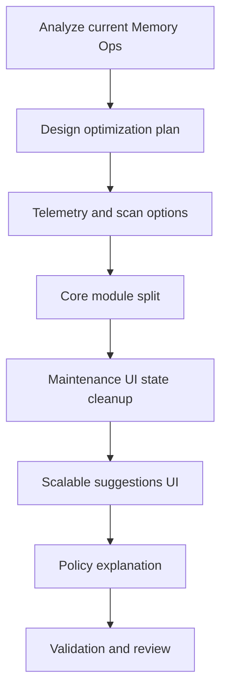

# Memory Ops Optimization Tasks

**关联需求**: [`requirements.md`](./requirements.md)

## Tasks

- ✅ T1 Analyze current Memory Ops
  - Dependencies: existing Memory Ops code and docs.
  - Blocks: T2-T8.
  - Files reviewed:
    - `src/lib/memory-ops.ts`
    - `src/lib/memory-ops-rules.ts`
    - `src/lib/memory-ops-policy.ts`
    - `src/lib/memory-ops-ui.ts`
    - `src/lib/memory-ops-executor.ts`
    - `src/lib/memory-ops-batch.ts`
    - `src/lib/memory-ops-rollback.ts`
    - `src/lib/local-maintenance-daemon.ts`
    - `src/components/settings/sections/maintenance-section.tsx`
    - `src/components/settings/sections/memory-ops-patrol-block.tsx`
    - `src/components/settings/sections/memory-ops-suggestion-groups.tsx`
    - `docs/llm-wiki-v2-memory-ops/requirements.md`
    - `docs/llm-wiki-v2-memory-ops/completion-audit.md`
    - `docs/llm-wiki-v2-final-5-percent/requirements.md`
  - Notes:
    - 🐛 遇到的问题: 当前工作区已有大量未提交改动，本轮先做优化规格，不直接改业务代码。
    - 🔧 最终实现逻辑: 通过源码和既有 dev-spec 文档确认 Memory Ops 已完整落地，主要优化点是可维护性、性能可观测性和大结果 UI。
    - 🎯 关键决策: 不重新设计 Memory Ops 产品方向，不引入外部 memory server。

- ✅ T2 Design optimization plan
  - Dependencies: T1.
  - Blocks: T3-T8.
  - Notes:
    - 🐛 遇到的问题: 直接实现会与当前大工作区改动叠加，风险偏高。
    - 🔧 最终实现逻辑: 新建 `docs/llm-wiki-v2-memory-ops-optimization/requirements.md`，把优化拆成 7 个功能要求。
    - 🎯 关键决策: 优先做可渐进落地的工程优化：telemetry/scan options -> module split -> UI list scalability -> policy explanation。

- ✅ T3 Telemetry and scan options
  - Dependencies: T2.
  - Blocks: T4, T8.
  - Subtasks:
    - Add Memory Ops scan telemetry types.
    - Add scan options for chat/self-healing/historical conflict scope.
    - Preserve full patrol defaults.
    - Add focused tests for skip behavior and stage timings.
  - Notes:
    - 🐛 遇到的问题: 新增 snapshot 字段后，几个测试夹具需要同步补 `scanTelemetry` 和 `scanDurationMs`。
    - 🔧 最终实现逻辑: 在 `scanMemoryOpsProject` 内记录阶段耗时，支持 `includeChatMessages`、`includeSelfHealing`、`maxChatConversations`；patrol 支持 `includeHistoricalConflicts: false`。
    - 🎯 关键决策: 默认仍保持全量扫描，只给轻量状态/预览调用开放降载选项；审计里只保存阶段计数和耗时，不保存路径或内容。

- ✅ T4 Core module split
  - Dependencies: T3.
  - Blocks: T5, T8.
  - Subtasks:
    - Move shared types to `memory-ops-types.ts`.
    - Extract scan orchestration to `memory-ops-scan.ts`.
    - Extract page evidence logic to `memory-ops-evidence.ts`.
    - Extract maintenance status/reduction logic to `memory-ops-maintenance.ts`.
    - Extract auto-patrol in-flight/failure audit to `memory-ops-autopatrol.ts`.
    - Keep `memory-ops.ts` as facade.
  - Notes:
    - 🐛 遇到的问题: `memory-ops.ts` 原本同时承担扫描、证据、维护状态和自动巡检，拆分时需要保留旧 import facade。
    - 🔧 最终实现逻辑: 新增 `memory-ops-types.ts`、`memory-ops-scan.ts`、`memory-ops-evidence.ts`、`memory-ops-maintenance.ts`、`memory-ops-autopatrol.ts`；`memory-ops.ts` 保留 patrol 编排和 re-export。
    - 🎯 关键决策: 先通过 facade 兼容旧调用，再让规则、冲突、自愈模块直接引用 shared types，降低循环依赖。

- ✅ T5 Maintenance UI state cleanup
  - Dependencies: T4.
  - Blocks: T6, T8.
  - Subtasks:
    - Extract reset helper for patrol run UI state.
    - Extract shared patrol-run-and-refresh helper.
    - Preserve policy-change patrol behavior.
    - Run focused Maintenance tests.
  - Notes:
    - 🐛 遇到的问题: 手动 patrol 与 policy 保存后的 patrol 状态清理逻辑重复，后续新增状态容易漏同步。
    - 🔧 最终实现逻辑: 抽出 `resetMemoryOpsPatrolState` 和 `runMemoryOpsPatrolAndRefresh`，统一清理 selection/batch/rollback/error 状态并并行刷新 audit 与 maintenance status。
    - 🎯 关键决策: 手动巡检仍清空旧 report；policy 保存后的自动巡检保留旧 report 直到新 report 返回，避免 UI 闪烁。

- ✅ T6 Scalable suggestions UI
  - Dependencies: T5.
  - Blocks: T7, T8.
  - Subtasks:
    - Replace hard 4-row category truncation with show-all/show-less or filtering.
    - Show category counts and selected count.
    - Make category selection include all eligible suggestions.
    - Add component tests for large categories.
  - Notes:
    - 🐛 遇到的问题: 原 UI 每类硬截断 4 条，分类选择也只选择可见项，大结果时会隐藏可批量建议。
    - 🔧 最终实现逻辑: 每类默认展示 4 条但可展开全部；分类头显示总数、已选数、可批量数；选择分类会选择整组所有可批量建议。
    - 🎯 关键决策: 保留默认折叠以避免维护页过长，同时不再丢失隐藏建议的批量操作能力。

- ✅ T7 Policy explanation
  - Dependencies: T6.
  - Blocks: T8.
  - Subtasks:
    - Add pure policy/status explanation helper.
    - Surface due/blocking gates in Memory Ops UI.
    - Add tests for threshold, cooldown, min interval, disabled automation, and clean state.
  - Notes:
    - 🐛 遇到的问题: UI 原来只展示 dirty/due/clean，不解释为什么 due、为什么提醒被 cooldown/min interval 挡住、自动巡检是否开启。
    - 🔧 最终实现逻辑: 新增 `memory-ops-policy-explanation.ts` 纯 helper，覆盖阈值进度、到期、时间间隔、冷却、最小间隔、自动巡检开关和干净状态，并接入 patrol notice。
    - 🎯 关键决策: 策略解释只展示门控摘要，不把完整 policy 表单重复塞进 patrol 卡片。

- ✅ T8 Validation and review
  - Dependencies: T3-T7.
  - Blocks: handoff.
  - Subtasks:
    - Run focused Memory Ops tests.
    - Run focused Maintenance/Patrol component tests.
    - Run `npm run typecheck`.
    - Run `npm run test:mocks`.
    - Write `review-round-1.md`.
  - Notes:
    - 🐛 遇到的问题: 当前工作区已有大量其它未提交改动，本轮验证只按 Memory Ops optimization 的变更范围确认。
    - 🔧 最终实现逻辑: 跑完 `npm run typecheck`、`npm run test:mocks` 和 `git diff --check`，并写入 `review-round-1.md`。
    - 🎯 关键决策: 本轮没有发现 P0/P1/P2；不引入更多 review 轮次，避免在当前大工作区上制造额外范围。
