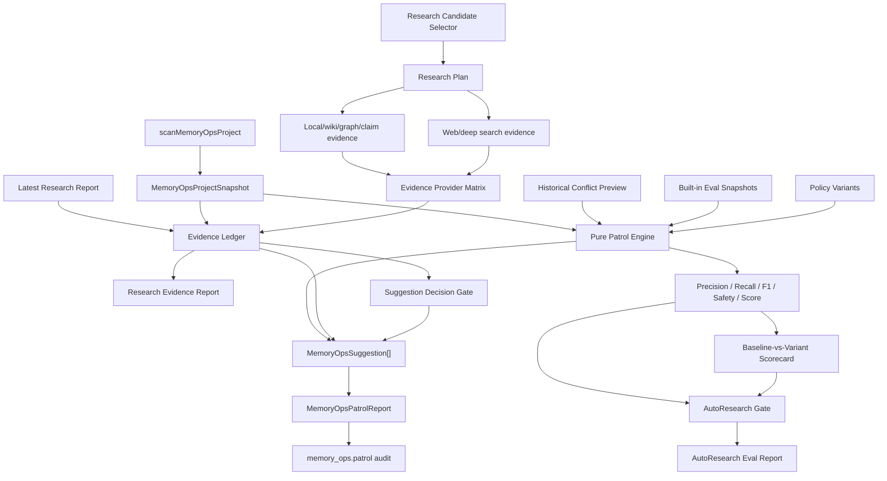

# Memory Ops Deep Research + AutoResearch Requirements

Status: Implementing
Date: 2026-05-22
Scale: Super-large

## Background

`memory-ops` is the subsystem that keeps the local LLM Wiki healthy. It scans wiki pages, typed graph state, claims, audit history, review items, chat traces, and self-healing summaries, then proposes safe maintenance actions.

The prior research/eval iteration added provider hooks and a UI surface, but it did not deeply change the core logic:

- Deep Research was only bounded multi-query web search.
- AutoResearch evaluation required injected runners and did not ship real memory-ops fixtures.
- Patrol decisions still flowed directly from scan rules to suggestions, with no reusable decision engine or evidence ledger.

This iteration upgrades `memory-ops` into a research-backed, measurable maintenance loop.

## Reference Inputs

- Local `/Users/xieao/code/llm-wiki` and `/Users/xieao/code/llm_wiki`: LLM Wiki architecture, LightRAG/typed graph notes, raw source/wiki/report layering, query/search/lint operations.
- [`nashsu/llm_wiki`](https://github.com/nashsu/llm_wiki): upstream project lineage for this repository.
- [`rohitg00/LLM Wiki v2`](https://gist.github.com/rohitg00/2067ab416f7bbe447c1977edaaa681e2): lifecycle, confidence, supersession, typed graph, hybrid search, automation hooks, score-everything, contradiction resolution, audit/governance.
- [`karpathy/autoresearch`](https://github.com/karpathy/autoresearch): AutoResearch-style loop of fixed budget experiments, one comparable metric, result logging, and keep/discard decisions.
- Existing local `search-health` and `search-eval`: scenario-based eval harness, deterministic expectations, report persistence, and audit trail.

## Goals

1. Make `memory-ops` decisions flow through a reusable, pure patrol engine.
2. Add an evidence ledger that can combine local wiki evidence, claim evidence, graph evidence, historical conflict evidence, and research report evidence.
3. Turn Deep Research from "web search provider" into a staged evidence loop:
   - plan evidence work,
   - gather local/wiki/graph/claim evidence,
   - run web/deep search when configured,
   - weigh support vs contradiction,
   - persist a cross-validation report.
4. Turn AutoResearch from "compare one live run" into a deterministic fixture and metric harness:
   - built-in synthetic snapshots,
   - expected suggestion labels,
   - precision/recall/F1,
   - safety and category coverage,
   - variant deltas and audit-ready reports.
5. Keep safety boundaries:
   - Memory Ops may propose metadata patches.
   - Research evidence may enrich or escalate suggestions.
   - It must not rewrite wiki body content or infer missing source refs silently.
6. Keep UI and storage compatible with existing reports while exposing richer evidence/eval signals.
7. Split new logic into bounded files and scan source file sizes after implementation.

## Non-goals

- Do not introduce a new external database.
- Do not require real web search or LLM credentials for default tests.
- Do not auto-apply research-backed suggestions without existing user approval flow.
- Do not replace the existing typed graph, claim, audit, or search modules.
- Do not run expensive real-LLM evals in `npm run test:mocks`.

## User Stories

1. As a user, I can run Memory Ops patrol and see suggestions that are grounded in lifecycle evidence, graph evidence, claim provenance, and latest research reports.
2. As a user, I can run Deep Research evidence validation and get an explainable report with support/contradiction/neutral evidence from local and web providers.
3. As a maintainer, I can run the eval harness without the app UI and get a deterministic report quantifying precision, recall, F1, safety, and coverage.
4. As a maintainer, I can adjust memory policy and see whether a stricter or looser policy improves eval metrics.
5. As a reviewer, I can inspect a patrol report and understand why a suggestion exists, whether evidence supports it, and whether it is safe to patch.

## Functional Requirements

### F1. Pure Patrol Engine

- Provide a pure `buildMemoryOpsPatrolReportFromSnapshot` function.
- It must accept a `MemoryOpsProjectSnapshot`, optional historical conflict result, optional latest research report, and trigger/today metadata.
- It must produce the same `MemoryOpsPatrolReport` shape currently returned by `runMemoryOpsPatrol`.
- `runMemoryOpsPatrol` must become scan/orchestration/audit glue around the pure engine.
- The pure engine must be usable by eval fixtures without filesystem access.

Acceptance:

- Built-in eval cases can run without injecting a patrol runner.
- Existing patrol behavior remains compatible.

### F2. Evidence Ledger

- Add a typed ledger model for candidate-level evidence.
- Ledger entries must capture:
  - source type (`local-page`, `claim`, `graph`, `historical-conflict`, `research-report`, `web`, `deep-research`),
  - stance (`support`, `contradict`, `neutral`, `unknown`),
  - score,
  - authority,
  - recency,
  - path/url/source id,
  - reasons.
- Ledger scoring must produce support score, contradiction score, neutral score, confidence, verdict, and decision recommendation.
- Suggestions enriched with research must carry a compact decision summary.

Acceptance:

- Unit tests verify supported, contradicted, mixed, insufficient, and unavailable decisions.
- A latest research report changes suggestion reasons and matched research stats.

### F3. Deep Research Evidence Loop

- Add a research plan builder for each candidate.
- The plan must include:
  - base query,
  - confirming queries,
  - disconfirming/contradiction queries,
  - local page probes,
  - graph neighbor probes,
  - claim/source probes,
  - web/deep provider queries.
- Local provider must use snapshot context when available, not only read the target file.
- Deep Research provider must run multiple planned queries and dedupe evidence.
- Evidence verdict must use weighted ledger scoring rather than raw count-only logic.

Acceptance:

- Tests verify local snapshot evidence can support or contradict a candidate without reading files.
- Tests verify Deep Research runs multiple planned queries, including disconfirming queries.
- Private claims remain redacted.

### F4. AutoResearch Eval Loop

- Built-in eval cases must include real synthetic `MemoryOpsProjectSnapshot` fixtures.
- Default `runMemoryOpsEval(projectPath)` must run built-in fixtures without an injected runner.
- Eval result must include:
  - case pass/fail,
  - expected/actual/matched suggestions,
  - false positives/false negatives,
  - safe patch count,
  - category coverage,
  - precision/recall/F1,
  - variant comparison when policy variants are supplied.
- Eval fixtures must cover stale page, low confidence, missing claim source refs, contradicted claim, superseded claim, archive, promotion, relation cleanup, research contradiction, and clean control.

Acceptance:

- Built-in eval should pass in tests.
- A deliberately wrong runner still reports precision/recall failure.

### F5. Policy and Metrics

- Extend policy with research and eval knobs using backwards-compatible defaults.
- Research policy should include max candidates, max evidence per candidate, stale report days, minimum confidence, contradiction escalation threshold, and provider defaults.
- Eval policy should include minimum precision, recall, and F1 targets.
- Normalization must preserve old policy files.

Acceptance:

- Policy tests cover defaults and invalid values.
- Existing saved policy shapes continue to load.

### F6. UI and Persistence Compatibility

- Existing research/eval panels must continue to render.
- UI should show richer metrics if available without breaking old reports.
- Store formats must be schema-versioned or optional-field compatible.

Acceptance:

- Existing component tests pass.
- Old report summaries remain readable.

### F7. Audit Trail

- Patrol audit event must include research/evidence summary.
- Eval report store must continue writing `.llm-wiki/memory-ops-eval/latest.json`.
- Research report store must continue writing `.llm-wiki/memory-ops-research/latest.json`.

Acceptance:

- Store tests pass and new audit summaries are redaction-safe.

### F8. Research Decision Gate

- Every patrol suggestion must carry a decision gate when generated by the engine.
- The gate must classify suggestions as:
  - `ready`,
  - `needs-research`,
  - `blocked-by-contradiction`,
  - `review-only`.
- Metadata patches contradicted by research must not be eligible for single or batch apply.
- Review-only suggestions must remain visible but non-applicable.

Acceptance:

- Unit tests prove contradicted research blocks apply.
- Batch apply checks the decision gate, not only `proposedOperation`.

### F9. AutoResearch Experiment Gate

- Eval reports must include an experiment gate with pass/fail and keep/discard decisions.
- The gate must compare precision, recall, and F1 against policy thresholds.
- Failed cases must also fail the gate even when aggregate metrics look acceptable.
- UI and audit summaries must expose the keep/discard decision.

Acceptance:

- Built-in fixtures produce `pass` / `keep`.
- Deliberately wrong runners produce `fail` / `discard`.

### F10. Deep Research Evidence Quorum

- Each candidate research result must include a provider-by-provider stance matrix.
- The matrix must count support, contradiction, neutral, unknown, and total evidence per provider.
- Candidate results must classify quorum as `met`, `weak`, `conflict`, or `unavailable`.
- Warning-level metadata patches with only weak supporting quorum must remain visible but blocked from apply.

Acceptance:

- Local-only support is `weak`; independent local + web support is `met`.
- Support and contradiction across providers is `conflict`.
- Decision gate tests prove weak quorum blocks warning metadata patches.

### F11. AutoResearch Scorecard

- Eval metrics must include a single patrol score that combines F1, exact-case pass rate, safe patch rate, and precision.
- Policy variants must report score delta against the baseline run.
- Variant keep/discard decisions must fail when candidate score regresses below baseline.
- UI summaries must expose patrol score and variant score deltas.

Acceptance:

- Built-in baseline reports a deterministic patrol score.
- A deliberately regressing policy variant reports negative score delta and `discard`.

## Non-functional Requirements

- Determinism: built-in eval fixtures must not require network, real LLM calls, timers, or local user data.
- Privacy: private claim text and private evidence snippets must be redacted in persisted research reports.
- Performance: default patrol must not run web search. Research validation is explicit/user-triggered.
- Type safety: avoid `any`; use narrow types and typed adapters.
- Source size: newly touched large files should be split when practical; source files over 400 lines must be reviewed and justified or split.

## Architecture

## Open Risks

- Stance inference from text remains heuristic unless an LLM judge is added later.
- Web provider availability is user-config dependent, so tests must use injected fake search.
- More evidence can increase false positives unless eval fixtures track clean controls and policy variants.

## Implementation Decisions

- Use existing local modules first: typed graph, claim confidence/provenance, lifecycle, audit, search-eval patterns.
- Do not make patrol network-dependent.
- Use `research-report` evidence as cached cross-validation during patrol.
- Block apply when research contradicts a metadata patch; keep the suggestion visible as review work.
- Treat single-provider support for warning patches as insufficient quorum, not as apply-ready evidence.
- Treat AutoResearch as an experiment gate: good policies are kept, regressing policies are discarded.
- Use one patrol score as the AutoResearch optimization signal so policy variants are comparable.
- Make all new default evals deterministic and fast.
- Add more fields as optional to avoid breaking old persisted reports.
