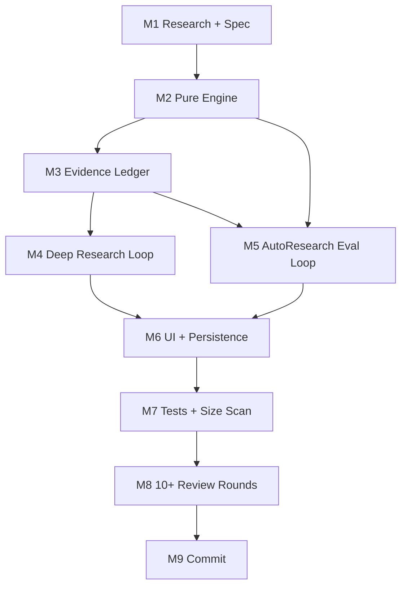

# Memory Ops Deep Research + AutoResearch Tasks

Status: Implementing
Scale: Super-large
Review rounds: 10+

## Dependency Graph

## M1. Research + Spec

- ✅ T1. Re-read `dev-spec-flow` and repo instructions.
  - Depends: none.
  - Blocks: all tasks.
  - Notes:
    - Implementation must follow research -> requirements/tasks -> dev loop -> 10+ review rounds.

- ✅ T2. Inspect current `memory-ops`, research, eval, policy, scan, and UI modules.
  - Depends: T1.
  - Blocks: T3, M2-M6.
  - Notes:
    - Current patrol is scan + direct rule evaluation + latest report enrichment.
    - Existing eval requires an injected runner and lacks real fixtures.

- ✅ T3. Inspect local and external references.
  - Depends: T1.
  - Blocks: M3-M5.
  - Notes:
    - Rohit LLM Wiki v2 emphasizes lifecycle, typed graph, scoring, self-healing, contradiction resolution, and audit.
    - AutoResearch emphasizes repeatable experiments, fixed budget, comparable score, and keep/discard loop.
    - Existing `search-health` gives a local pattern for deterministic eval reports.

- ✅ T4. Write requirements and task plan.
  - Depends: T1-T3.
  - Blocks: M2.
  - Notes:
    - This document is the implementation control plane.

## M2. Pure Patrol Engine

- ✅ T5. Add `memory-ops-engine.ts` pure patrol report builder.
  - Depends: T4.
  - Blocks: T6, T17.
  - Notes:
    - Inputs: snapshot, historical conflicts, latest research, trigger/today.
    - Output: existing `MemoryOpsPatrolReport`.

- ⏳ T6. Refactor `runMemoryOpsPatrol` to orchestrate scan/history/research/audit around the engine.
  - Depends: T5.
  - Blocks: T24.
  - Notes:
    - Preserve audit shape and maintenance cooldown behavior.

- ✅ T7. Add engine unit tests for existing behavior preservation.
  - Depends: T5.
  - Blocks: M7.

## M3. Evidence Ledger

- ✅ T8. Add typed evidence ledger model.
  - Depends: T4.
  - Blocks: T9-T12.

- ✅ T9. Add ledger scoring and verdict functions.
  - Depends: T8.
  - Blocks: T10-T12.

- ✅ T10. Convert latest research report results into ledger entries.
  - Depends: T8-T9.
  - Blocks: T11, T24.

- ✅ T11. Enrich suggestions with ledger-based research decision summary.
  - Depends: T10.
  - Blocks: T24.

- ✅ T12. Add evidence ledger tests.
  - Depends: T8-T11.
  - Blocks: M7.

## M4. Deep Research Evidence Loop

- ✅ T13. Add research plan builder with confirming/disconfirming/local/graph/claim/web probes.
  - Depends: T4, T8.
  - Blocks: T14-T16.

- ✅ T14. Upgrade local provider to use snapshot context.
  - Depends: T13.
  - Blocks: T16.

- ✅ T15. Upgrade deep-research provider to execute planned multi-query evidence gathering.
  - Depends: T13.
  - Blocks: T16.

- ✅ T16. Switch research verdicts to weighted ledger scoring.
  - Depends: T9, T14-T15.
  - Blocks: T24.

- ✅ T17. Add research loop tests with fake local snapshot and fake web search.
  - Depends: T13-T16.
  - Blocks: M7.

## M5. AutoResearch Eval Loop

- ✅ T18. Add built-in synthetic snapshot fixtures.
  - Depends: T5.
  - Blocks: T19-T21.

- ✅ T19. Make default `runMemoryOpsEval` run built-in fixtures without injected runner.
  - Depends: T18.
  - Blocks: T20.

- ✅ T20. Add policy variant comparison metrics.
  - Depends: T19.
  - Blocks: T21, T24.

- ✅ T21. Add AutoResearch eval tests for passing built-ins and failing wrong runner.
  - Depends: T18-T20.
  - Blocks: M7.

## M6. Policy, UI, Persistence

- ✅ T22. Extend `MemoryOpsPolicy` with research/eval knobs and backwards-compatible normalization.
  - Depends: T4.
  - Blocks: T23-T24.

- ✅ T23. Update policy tests and explanation text.
  - Depends: T22.
  - Blocks: M7.

- ✅ T24. Update research/eval panels and hook code to surface richer summaries.
  - Depends: T6, T11, T16, T20.
  - Blocks: M7.

- ✅ T25. Verify persisted report compatibility.
  - Depends: T10, T20.
  - Blocks: M7.

## M7. Tests + Source Size

- ✅ T26. Run focused memory-ops tests.
  - Depends: M2-M6.
  - Blocks: T28.

- ✅ T27. Run `npm run typecheck`.
  - Depends: M2-M6.
  - Blocks: T28.

- ✅ T28. Run `npm run test:mocks`.
  - Depends: T26-T27.
  - Blocks: T30.

- ✅ T29. Scan source files over 400 lines and split new/changed files where practical.
  - Depends: M2-M6.
  - Blocks: T30.

## M8. Final Review Rounds

- ✅ T30. Review round 1: requirements coverage.
- ✅ T31. Review round 2: pure engine determinism.
- ✅ T32. Review round 3: evidence scoring correctness.
- ✅ T33. Review round 4: research provider privacy/redaction.
- ✅ T34. Review round 5: eval metric validity.
- ✅ T35. Review round 6: backwards compatibility.
- ✅ T36. Review round 7: UI/persistence smoke.
- ✅ T37. Review round 8: performance and network boundaries.
- ✅ T38. Review round 9: source size/module boundaries.
- ✅ T39. Review round 10: final regression sweep.

Each review writes `review-round-N.md` with findings and fixes.

## M9. Commit

- ✅ T40. Stage docs/code/tests.
- ✅ T41. Commit with a focused prefixed message.
- ⏳ T42. Mark goal complete.
