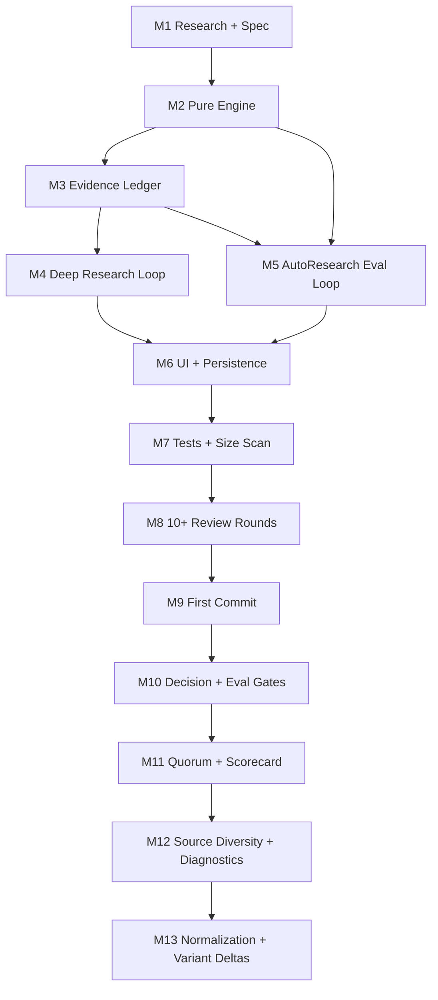

# Memory Ops Deep Research + AutoResearch Tasks

Status: Implemented
Scale: Super-large
Review rounds: 10+

## Dependency Graph

## M1. Research + Spec

- ✅ T1. Re-read `dev-spec-flow` and repo instructions.
  - Depends: none.
  - Blocks: all tasks.
  - Notes:
    - Implementation must follow research -> requirements/tasks -> dev loop -> 10+ review rounds.

- ✅ T2. Inspect current `memory-ops`, research, eval, policy, scan, and UI modules.
  - Depends: T1.
  - Blocks: T3, M2-M6.
  - Notes:
    - Current patrol is scan + direct rule evaluation + latest report enrichment.
    - Existing eval requires an injected runner and lacks real fixtures.

- ✅ T3. Inspect local and external references.
  - Depends: T1.
  - Blocks: M3-M5.
  - Notes:
    - Rohit LLM Wiki v2 emphasizes lifecycle, typed graph, scoring, self-healing, contradiction resolution, and audit.
    - AutoResearch emphasizes repeatable experiments, fixed budget, comparable score, and keep/discard loop.
    - Existing `search-health` gives a local pattern for deterministic eval reports.

- ✅ T4. Write requirements and task plan.
  - Depends: T1-T3.
  - Blocks: M2.
  - Notes:
    - This document is the implementation control plane.

## M2. Pure Patrol Engine

- ✅ T5. Add `memory-ops-engine.ts` pure patrol report builder.
  - Depends: T4.
  - Blocks: T6, T17.
  - Notes:
    - Inputs: snapshot, historical conflicts, latest research, trigger/today.
    - Output: existing `MemoryOpsPatrolReport`.

- ✅ T6. Refactor `runMemoryOpsPatrol` to orchestrate scan/history/research/audit around the engine.
  - Depends: T5.
  - Blocks: T24.
  - Notes:
    - Preserve audit shape and maintenance cooldown behavior.
    - `runMemoryOpsPatrol` now delegates report assembly to the pure engine after scan/history/research loading.

- ✅ T7. Add engine unit tests for existing behavior preservation.
  - Depends: T5.
  - Blocks: M7.

## M3. Evidence Ledger

- ✅ T8. Add typed evidence ledger model.
  - Depends: T4.
  - Blocks: T9-T12.

- ✅ T9. Add ledger scoring and verdict functions.
  - Depends: T8.
  - Blocks: T10-T12.

- ✅ T10. Convert latest research report results into ledger entries.
  - Depends: T8-T9.
  - Blocks: T11, T24.

- ✅ T11. Enrich suggestions with ledger-based research decision summary.
  - Depends: T10.
  - Blocks: T24.

- ✅ T12. Add evidence ledger tests.
  - Depends: T8-T11.
  - Blocks: M7.

## M4. Deep Research Evidence Loop

- ✅ T13. Add research plan builder with confirming/disconfirming/local/graph/claim/web probes.
  - Depends: T4, T8.
  - Blocks: T14-T16.

- ✅ T14. Upgrade local provider to use snapshot context.
  - Depends: T13.
  - Blocks: T16.

- ✅ T15. Upgrade deep-research provider to execute planned multi-query evidence gathering.
  - Depends: T13.
  - Blocks: T16.

- ✅ T16. Switch research verdicts to weighted ledger scoring.
  - Depends: T9, T14-T15.
  - Blocks: T24.

- ✅ T17. Add research loop tests with fake local snapshot and fake web search.
  - Depends: T13-T16.
  - Blocks: M7.

## M5. AutoResearch Eval Loop

- ✅ T18. Add built-in synthetic snapshot fixtures.
  - Depends: T5.
  - Blocks: T19-T21.

- ✅ T19. Make default `runMemoryOpsEval` run built-in fixtures without injected runner.
  - Depends: T18.
  - Blocks: T20.

- ✅ T20. Add policy variant comparison metrics.
  - Depends: T19.
  - Blocks: T21, T24.

- ✅ T21. Add AutoResearch eval tests for passing built-ins and failing wrong runner.
  - Depends: T18-T20.
  - Blocks: M7.

## M6. Policy, UI, Persistence

- ✅ T22. Extend `MemoryOpsPolicy` with research/eval knobs and backwards-compatible normalization.
  - Depends: T4.
  - Blocks: T23-T24.

- ✅ T23. Update policy tests and explanation text.
  - Depends: T22.
  - Blocks: M7.

- ✅ T24. Update research/eval panels and hook code to surface richer summaries.
  - Depends: T6, T11, T16, T20.
  - Blocks: M7.

- ✅ T25. Verify persisted report compatibility.
  - Depends: T10, T20.
  - Blocks: M7.

## M7. Tests + Source Size

- ✅ T26. Run focused memory-ops tests.
  - Depends: M2-M6.
  - Blocks: T28.

- ✅ T27. Run `npm run typecheck`.
  - Depends: M2-M6.
  - Blocks: T28.

- ✅ T28. Run `npm run test:mocks`.
  - Depends: T26-T27.
  - Blocks: T30.

- ✅ T29. Scan source files over 400 lines and split new/changed files where practical.
  - Depends: M2-M6.
  - Blocks: T30.

## M8. Final Review Rounds

- ✅ T30. Review round 1: requirements coverage.
- ✅ T31. Review round 2: pure engine determinism.
- ✅ T32. Review round 3: evidence scoring correctness.
- ✅ T33. Review round 4: research provider privacy/redaction.
- ✅ T34. Review round 5: eval metric validity.
- ✅ T35. Review round 6: backwards compatibility.
- ✅ T36. Review round 7: UI/persistence smoke.
- ✅ T37. Review round 8: performance and network boundaries.
- ✅ T38. Review round 9: source size/module boundaries.
- ✅ T39. Review round 10: final regression sweep.

Each review writes `review-round-N.md` with findings and fixes.

## M9. Commit

- ✅ T40. Stage docs/code/tests.
- ✅ T41. Commit with a focused prefixed message.
- 🚧 T42. Mark goal complete.

## M10. Second Deepening Pass

- ✅ T43. Add suggestion decision gate.
  - Depends: M3-M4.
  - Blocks: T44.
  - Notes:
    - Suggestions now carry ready/needs-research/blocked/review-only decisions.

- ✅ T44. Block single/batch apply when research contradicts a metadata patch.
  - Depends: T43.
  - Blocks: T47.
  - Notes:
    - Batch eligibility now checks the decision gate.

- ✅ T45. Add AutoResearch pass/fail keep/discard gate.
  - Depends: M5-M6.
  - Blocks: T46.
  - Notes:
    - Eval report gate compares metrics against policy thresholds.

- ✅ T46. Surface experiment decision in eval UI and audit.
  - Depends: T45.
  - Blocks: T47.

- ✅ T47. Add focused tests for gates.
  - Depends: T43-T46.
  - Blocks: T48.

- ✅ T48. Run final full validation and commit second pass.
  - Depends: T47.
  - Notes:
    - `npm run typecheck` passed.
    - `npm run test:mocks` passed: 172 files, 1568 tests.
    - New/modified Memory Ops source files are under 400 lines after splitting decision/category UI helpers.

## M11. Third Deepening Pass: Quorum + Scorecard

- ✅ T49. Add provider evidence matrix and quorum classification.
  - Depends: M4.
  - Blocks: T50.
  - Notes:
    - Research results now carry per-provider support/contradict/neutral/unknown counts.
    - Summary includes quorum counts: met, weak, conflict, unavailable.

- ✅ T50. Wire quorum into suggestion decision gate.
  - Depends: T49.
  - Blocks: T53.
  - Notes:
    - Warning metadata patches with only weak supporting quorum are blocked as `needs-research`.

- ✅ T51. Add AutoResearch patrol score.
  - Depends: M5.
  - Blocks: T52.
  - Notes:
    - Score combines F1, exact-case pass rate, safe patch rate, and precision.

- ✅ T52. Add baseline-aware variant score deltas.
  - Depends: T51.
  - Blocks: T53.
  - Notes:
    - Variant gates now discard candidates whose patrol score regresses below baseline.

- ✅ T53. Surface quorum and scorecard in UI/i18n.
  - Depends: T49-T52.
  - Blocks: T54.

- ✅ T54. Run final validation, size scan, review round 12, and commit.
  - Depends: T53.
  - Notes:
    - `npm run typecheck` passed.
    - `npm run test:mocks` passed: 172 files, 1571 tests.
    - New/modified Memory Ops source files remain under 400 lines.

## M12. Fourth Deepening Pass: Source Diversity + Diagnostics

- ✅ T55. Add independent source keys to research evidence matrix.
  - Depends: T49.
  - Blocks: T56.
  - Notes:
    - Web evidence uses normalized hostnames.
    - Local evidence uses normalized paths.

- ✅ T56. Make quorum require source diversity, not just provider count.
  - Depends: T55.
  - Blocks: T57.
  - Notes:
    - Multiple providers citing one host stay `weak`.

- ✅ T57. Wire source diversity into decision gate.
  - Depends: T56.
  - Blocks: T60.
  - Notes:
    - Warning patches need independent source diversity before apply.

- ✅ T58. Add case-level eval failure reasons and score breakdown.
  - Depends: T51.
  - Blocks: T59.
  - Notes:
    - Cases now explain missing and unexpected suggestions.
    - Metrics aggregate case match/precision/safety totals.

- ✅ T59. Normalize legacy eval diagnostics on load.
  - Depends: T58.
  - Blocks: T60.

- ✅ T60. Surface source diversity and eval diagnostics in UI/i18n.
  - Depends: T55-T59.
  - Blocks: T61.

- ✅ T61. Run final validation, size scan, review round 13, and commit.
  - Depends: T60.
  - Notes:
    - `npm run typecheck` passed.
    - `npm run test:mocks` passed: 172 files, 1573 tests.
    - New/modified Memory Ops source files remain under 400 lines.

## M13. Fifth Deepening Pass: Normalization + Variant Deltas

- ✅ T62. Normalize legacy research reports with missing evidence matrix/source diversity fields.
  - Depends: T55-T56.
  - Blocks: T63, T66.
  - Notes:
    - Rebuild provider matrices from `providerResults` when persisted reports predate quorum/source keys.

- ⏳ T63. Add source diversity details to research audit reasons.
- ✅ T63. Add source diversity details to research audit reasons.
  - Depends: T62.
  - Blocks: T66.

- ✅ T64. Add AutoResearch per-case variant regression diagnostics.
  - Depends: T58.
  - Blocks: T65-T66.

- ✅ T65. Surface variant regression diagnostics in UI/i18n.
  - Depends: T64.
  - Blocks: T66.

- ✅ T66. Add focused regression tests for report normalization and variant deltas.
  - Depends: T62-T65.
  - Blocks: T67.

- ✅ T67. Run full validation, size scan, review round 14, and commit.
  - Depends: T66.
  - Notes:
    - `npm run typecheck` passed.
    - `npm run test:mocks` passed: 172 files, 1576 tests.
    - Focused eval/research store tests passed: 3 files, 12 tests.
    - Touched source files are under 400 lines after extracting eval diagnostics and research matrix helpers.
