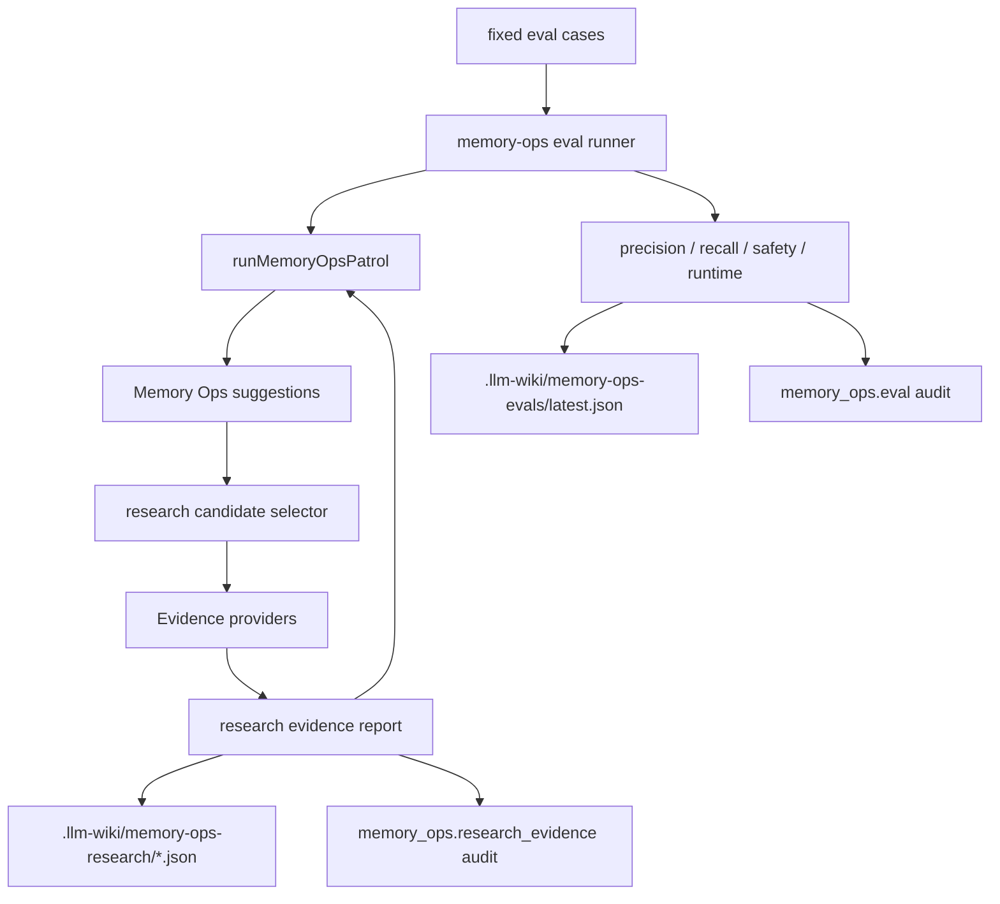

# Requirements — Memory Ops Research Evidence And Eval Loops

**Version**: v0.1
**Date**: 2026-05-21
**Author**: User + Codex
**Status**: Implemented
**Task List**: [tasks.md](./tasks.md)

---

## 1. Background

`memory-ops` already patrols the local wiki, claims, audit timeline, typed graph, and review state. It can find stale pages, weak claims, dangling relations, missing provenance, and historical conflicts. That is valuable, but it is mostly an internal consistency pass.

The next iteration must close two gaps:

- **Cross-verification gap**: without a research evidence loop, Memory Ops can say "this claim is stale or weak inside the wiki" but cannot gather fresh external evidence and classify support, contradiction, or uncertainty.
- **Measurement gap**: without an AutoResearch-style eval loop, changes to Memory Ops rules are judged by intuition and snapshot counts rather than repeatable precision, recall, safety, runtime, and cost proxies.

Research inputs:

- Current v2 code: `src/lib/memory-ops*.ts`, `src/lib/search-health*.ts`, `src/lib/prewrite-conflict*.ts`, `src/lib/claim*.ts`.
- Original Karpathy LLM Wiki idea in `/Users/xieao/code/llm-wiki`.
- Upstream `nashsu/llm_wiki`, especially `src/lib/deep-research.ts` and `src/lib/web-search.ts`.
- Rohit LLM Wiki v2 gist and existing gap analysis.
- OpenAI official Deep Research / web search guidance: use a provider abstraction so OpenAI Responses Deep Research can be added without coupling Memory Ops to one API surface.
- `karpathy/autoresearch`: fixed tasks, bounded attempts, repeatable scoring, and experiment logs; adapted here as deterministic wiki fixtures and Memory Ops metrics.

---

## 2. Goals

### 2.1 In Scope

- Add a **research evidence loop** for Memory Ops suggestions and high-risk claims.
- Support deterministic/manual evidence providers first:
  - project-local source/wiki evidence
  - existing configured web search providers
  - a future-ready provider interface for OpenAI Deep Research / Responses API
- Store compact, auditable evidence reports under `.llm-wiki/`.
- Surface external evidence and verdicts in Memory Ops patrol reports and UI.
- Add an **AutoResearch-style eval harness** with fixed synthetic wiki fixtures.
- Report precision, recall, false positives, patch safety, runtime, and suggestion-category coverage.
- Add tests for providers, storage, Memory Ops integration, eval metrics, and UI-adjacent summaries.
- Scan for oversized source files after implementation and split new/changed code where reasonable.

### 2.2 Out Of Scope

- No silent Markdown rewrites from research evidence.
- No full autonomous web crawler or unbounded agent loop.
- No remote memory server or multi-agent mesh sync.
- No mandatory OpenAI dependency; OpenAI Deep Research remains a provider-compatible extension point unless the existing app already has a configured OpenAI key.
- No real network calls in default tests.
- No OS-level daemon outside the running Tauri app.

### 2.3 Success Criteria

- A user can run a Memory Ops patrol and see research-needed candidates identified.
- A user can run evidence validation for selected suggestions or high-risk claims.
- Evidence reports are persisted and audited without leaking full private claim text in audit events.
- A user can run Memory Ops eval and get repeatable metrics.
- Default `npm run typecheck` and focused Vitest suites pass.
- New implementation code is decomposed into files under roughly 400 lines where practical.

---

## 3. User Scenarios

### 3.1 Validate A Stale Claim

**Role**: wiki maintainer

**Preconditions**: project open; Memory Ops has generated a stale or low-confidence claim suggestion.

**Steps**:
1. User opens Settings -> Maintenance -> Research/Eval.
2. User runs evidence validation for current patrol candidates.
3. System selects bounded candidates and gathers evidence.
4. System classifies each candidate as supported, contradicted, mixed, insufficient, or unavailable.
5. User opens a report and decides whether to update, ignore, or manually research further.

**Expected Result**: evidence report exists under `.llm-wiki/memory-ops-research/`, `memory_ops.research_evidence` audit is appended, and Memory Ops suggestions gain evidence summary metadata.

### 3.2 Measure A Rule Change

**Role**: developer

**Preconditions**: local checkout with tests available.

**Steps**:
1. Developer runs Memory Ops eval from the maintenance panel or library helper.
2. System creates or uses fixed fixture projects.
3. System runs patrol and compares suggestions against expected labels.
4. System writes metrics and an audit event.

**Expected Result**: report shows precision/recall/F1, false positive count, false negative count, patch safety count, runtime, and category coverage.

### 3.3 Network Is Not Configured

**Role**: local-first user

**Preconditions**: no Tavily/SerpApi/SearXNG/OpenAI research provider configured.

**Steps**:
1. User runs evidence validation.
2. System uses local evidence only or reports provider unavailable.

**Expected Result**: no crash, no unauthorized network attempt, report status is `unavailable` or `insufficient`, and audit records a safe summary.

---

## 4. Functional Requirements

### F1: Research Evidence Data Model

**Description**: Define typed evidence candidates, sources, verdicts, and reports.

**Inputs**: Memory Ops suggestions, claims, wiki pages, optional web/deep research results.

**Behavior**: Normalize candidates and evidence into compact serializable reports.

**Outputs**: `MemoryOpsResearchEvidenceReport`.

**Acceptance**:
- [ ] Verdicts include `supported`, `contradicted`, `mixed`, `insufficient`, and `unavailable`.
- [ ] Evidence items include provider, URL/path, title, snippet/summary, published date when available, and support/contradict/neutral stance.
- [ ] Private scoped claims use redacted text in audit-safe fields.

### F2: Provider Abstraction

**Description**: Add a provider interface that can run local/web/OpenAI-style research without coupling patrol to one vendor.

**Inputs**: candidate, policy/config, optional fetch/search implementation.

**Behavior**: Runs bounded evidence gathering and returns normalized evidence.

**Outputs**: provider result with warnings and optional cost/runtime estimates.

**Acceptance**:
- [ ] Local provider works without network.
- [ ] Web search provider reuses existing `webSearch` config and network policy behavior.
- [ ] OpenAI Deep Research provider is represented as an interface-compatible placeholder or implementation that can be enabled later without changing Memory Ops call sites.
- [ ] Providers are bounded by max candidates/results/tool-call-like limits.

### F3: Evidence Storage And Audit

**Description**: Persist reports under `.llm-wiki/memory-ops-research/`.

**Inputs**: project path and report.

**Behavior**: Writes JSON report and appends audit summary.

**Outputs**: written path and `memory_ops.research_evidence` audit event.

**Acceptance**:
- [ ] Write failures are returned, not thrown through UI.
- [ ] Audit event contains counts/verdicts but not long/private evidence text.
- [ ] Latest report can be loaded.

### F4: Memory Ops Patrol Integration

**Description**: Use evidence summaries to enhance suggestions and identify research-needed candidates.

**Inputs**: patrol snapshot, suggestions, optional recent evidence report.

**Behavior**: Attaches evidence summary and emits research-needed suggestions for high-risk unverified claims/pages.

**Outputs**: enriched suggestions and stats.

**Acceptance**:
- [ ] Patrol remains deterministic and does not perform network research by default.
- [ ] Evidence report integration is optional and best-effort.
- [ ] `MemoryOpsPatrolStats` includes evidence report counts when available.

### F5: Manual Research Run UI

**Description**: Add a Maintenance tab/panel for evidence validation.

**Inputs**: selected/current patrol suggestions and project config.

**Behavior**: Runs bounded evidence validation, shows verdict summary, warnings, and report path.

**Outputs**: report state in UI.

**Acceptance**:
- [ ] Button disabled when no project is open.
- [ ] Network-unavailable state is understandable.
- [ ] UI does not include long instructional text or marketing content.

### F6: AutoResearch Eval Harness

**Description**: Add repeatable fixtures and metrics for Memory Ops.

**Inputs**: fixed eval cases with wiki pages, claims, expected suggestions, and expected safe patch count.

**Behavior**: Runs patrol against cases, compares suggestions to labels, aggregates metrics.

**Outputs**: `MemoryOpsEvalReport`.

**Acceptance**:
- [ ] Metrics include precision, recall, F1, false positives, false negatives, category coverage, safe patch count, runtime.
- [ ] Fixture cases cover stale page, low confidence, promotion, archive, relation cleanup, contradicted/superseded claim, missing provenance, and no-issue control.
- [ ] Eval can be called from tests without Tauri FS by injecting a runner/searcher or temporary adapter.

### F7: Eval Storage And UI

**Description**: Persist eval reports and display the latest result in Maintenance.

**Inputs**: eval report.

**Behavior**: Writes `.llm-wiki/memory-ops-evals/latest.json` and an audit event.

**Outputs**: latest report and audit summary.

**Acceptance**:
- [ ] Report write is best-effort.
- [ ] UI shows precision/recall/F1 and failures compactly.
- [ ] Audit action is `memory_ops.eval`.

---

## 5. Non-Functional Requirements

### 5.1 Performance

- Default patrol must not perform network calls.
- Evidence validation defaults to a small candidate cap.
- Eval fixtures should run in seconds in mock tests.
- Historical conflict and research evidence scans must stay bounded.

### 5.2 Security And Privacy

- Use existing network policy wrappers for outbound HTTP.
- No API keys or raw private claim text in audit events.
- Path writes must stay under the project root.
- External evidence snippets are bounded.

### 5.3 Observability

- Append audit events for research evidence runs and eval runs.
- Include runtime, candidate counts, provider names, verdict distribution, and warnings.

### 5.4 Internationalization

- Add English and Chinese strings for any new visible UI labels.

---

## 6. Architecture

### Module Plan

- `src/lib/memory-ops-research-types.ts`
- `src/lib/memory-ops-research.ts`
- `src/lib/memory-ops-research-store.ts`
- `src/lib/memory-ops-research-integration.ts`
- `src/lib/memory-ops-eval-types.ts`
- `src/lib/memory-ops-eval-fixtures.ts`
- `src/lib/memory-ops-eval.ts`
- `src/lib/memory-ops-eval-store.ts`
- `src/components/settings/sections/memory-ops-research-panel.tsx`
- `src/components/settings/sections/memory-ops-eval-panel.tsx`

---

## 7. Risks

| Risk | Probability | Impact | Mitigation |
|------|-------------|--------|------------|
| Evidence provider hallucinates support | Medium | High | Treat provider output as evidence hints only; human applies changes. |
| Network cost surprises | Medium | Medium | Default local/no-network path, explicit manual run, candidate/result caps. |
| UI component grows too large | High | Medium | Split panels into separate files. |
| Existing dirty worktree conflicts | High | Medium | Avoid broad refactors and do not revert unrelated changes. |
| Metrics become gamed by fixtures | Medium | Medium | Keep fixtures transparent and include no-issue controls. |

---

## 8. Open Decisions

- Default provider: local evidence only, with optional web search if configured.
- OpenAI Deep Research: provider-compatible extension point now; full Responses background-mode integration can be added after app-level API config and UX are settled.
- Commit cadence: skip per-task commits in this worktree because many unrelated modifications already exist.
