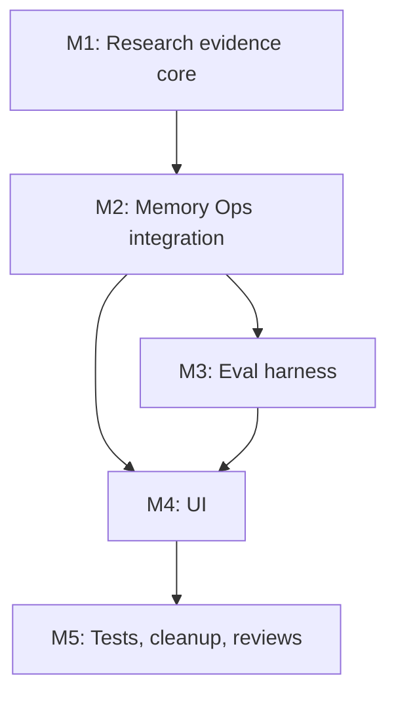

# Tasks — Memory Ops Research Evidence And Eval Loops

**Requirements**: [requirements.md](./requirements.md)
**Estimated Size**: Medium-large (5 review rounds)
**Progress**: ✅ 16 / 16

---

## Milestone Dependency Graph

---

## Milestone 1: Research Evidence Core ✅

### Task 1.1 ✅ Define research evidence model

**Files**:
- `src/lib/memory-ops-research-types.ts`

**Notes**
- 🐛 **Issues**: Report summary warning counts initially double-counted provider warnings.
- 🔧 **Implementation**: Added typed candidates, provider results, evidence items, verdict counts, report summaries, and suggestion-level research summaries.
- 🎯 **Decision**: Keep source objects out of persisted candidate results and redact private summaries before report/audit use.

### Task 1.2 ✅ Implement local, web, and Deep Research evidence providers

**Files**:
- `src/lib/memory-ops-research.ts`
- `src/lib/memory-ops-research-providers.ts`
- `src/lib/memory-ops-research.test.ts`

**Notes**
- 🐛 **Issues**: Local stance initially overreacted to candidate reasons like “stale claim”; stance now uses evidence text.
- 🔧 **Implementation**: Added local wiki evidence, existing `webSearch` evidence, and bounded Deep Research multi-query evidence with URL de-duplication.
- 🎯 **Decision**: Deep Research uses configured web-search infrastructure today and returns `unavailable` when no search provider exists, preserving local-first behavior.

### Task 1.3 ✅ Implement evidence storage and audit

**Files**:
- `src/lib/memory-ops-research-store.ts`
- `src/lib/memory-ops-research-store.test.ts`

**Notes**
- 🐛 **Issues**: None remaining.
- 🔧 **Implementation**: Persisted timestamped and latest reports under `.llm-wiki/memory-ops-research/`, with `memory_ops.research_evidence` audit summaries.
- 🎯 **Decision**: Write failures are returned in result objects so UI can show partial success without crashing.

---

## Milestone 2: Memory Ops Integration ✅

### Task 2.1 ✅ Candidate selection and suggestion enrichment

**Files**:
- `src/lib/memory-ops-research-integration.ts`
- `src/lib/memory-ops-research-integration.test.ts`
- `src/lib/memory-ops-types.ts`

**Notes**
- 🐛 **Issues**: Older test fixtures did not include new stats fields.
- 🔧 **Implementation**: Selected high-risk suggestions first, then stale/weak claims and risky pages; enriched matching suggestions with latest report verdicts.
- 🎯 **Decision**: Research stats are optional on snapshot types and normalized to zero in UI summaries for backward compatibility.

### Task 2.2 ✅ Wire integration into patrol

**Files**:
- `src/lib/memory-ops.ts`
- `src/lib/memory-ops-scan.ts`
- `src/lib/memory-ops-ui.ts`

**Notes**
- 🐛 **Issues**: None remaining.
- 🔧 **Implementation**: Patrol loads latest evidence best-effort, enriches suggestions, reports research candidate/evidence/match/warning counts, and audits compact summary.
- 🎯 **Decision**: Patrol still never performs network research; manual evidence runs are separate.

---

## Milestone 3: AutoResearch Eval Harness ✅

### Task 3.1 ✅ Define eval model and fixtures

**Files**:
- `src/lib/memory-ops-eval-types.ts`
- `src/lib/memory-ops-eval-fixtures.ts`

**Notes**
- 🐛 **Issues**: Initial fixture set was too narrow.
- 🔧 **Implementation**: Added stable labels covering stale, low confidence, archive, promotion, relation cleanup, missing provenance, contradicted claim, superseded claim, and clean control.
- 🎯 **Decision**: Keep fixtures as transparent labels plus injectable runners, so tests can stay deterministic without Tauri FS.

### Task 3.2 ✅ Implement eval runner and metrics

**Files**:
- `src/lib/memory-ops-eval.ts`
- `src/lib/memory-ops-eval.test.ts`

**Notes**
- 🐛 **Issues**: Category coverage was missing from the first metrics shape.
- 🔧 **Implementation**: Added precision, recall, F1, false positives, false negatives, safe patch count, runtime, and expected/actual category coverage.
- 🎯 **Decision**: UI uses a current-project regression case; library tests can inject true synthetic fixture runners.

### Task 3.3 ✅ Implement eval storage and audit

**Files**:
- `src/lib/memory-ops-eval-store.ts`
- `src/lib/memory-ops-eval-store.test.ts`

**Notes**
- 🐛 **Issues**: Store test fixture needed the new category coverage fields.
- 🔧 **Implementation**: Persisted `.llm-wiki/memory-ops-evals/latest.json` and appended `memory_ops.eval` audit summaries.
- 🎯 **Decision**: Failed evals audit with error-like status to make regressions visible in timeline.

---

## Milestone 4: Maintenance UI ✅

### Task 4.1 ✅ Add research evidence panel

**Files**:
- `src/components/settings/sections/memory-ops-research-panel.tsx`
- `src/components/settings/sections/use-memory-ops-research-eval.ts`
- `src/components/settings/sections/maintenance-section.tsx`

**Notes**
- 🐛 **Issues**: Adding handlers directly would have grown the already-large maintenance section.
- 🔧 **Implementation**: Added an Evidence tab that runs manual evidence validation, shows verdict distribution, warnings, report path, and candidates needing review.
- 🎯 **Decision**: Flow orchestration lives in `use-memory-ops-research-eval.ts`; the panel stays presentational.

### Task 4.2 ✅ Add eval panel

**Files**:
- `src/components/settings/sections/memory-ops-eval-panel.tsx`
- `src/components/settings/sections/use-memory-ops-research-eval.ts`

**Notes**
- 🐛 **Issues**: None remaining.
- 🔧 **Implementation**: Added Eval tab with precision/recall/F1, case counts, safe patches, failure details, report open action, and clear empty/error states.
- 🎯 **Decision**: The current UI eval compares a fresh patrol against the current patrol baseline for stability; deeper fixture execution remains in the library harness.

### Task 4.3 ✅ Add i18n strings

**Files**:
- `src/i18n/en.json`
- `src/i18n/zh.json`

**Notes**
- 🐛 **Issues**: None remaining.
- 🔧 **Implementation**: Added English and Chinese strings for new tabs, panels, summary labels, warnings, and result labels.
- 🎯 **Decision**: Verified structural parity with `src/i18n/i18n-parity.test.ts`.

---

## Milestone 5: Verification, Cleanup, Reviews ✅

### Task 5.1 ✅ Focused tests

**Notes**
- 🐛 **Issues**: Focused tests exposed stance inference and fixture type gaps; both fixed.
- 🔧 **Implementation**: Ran Memory Ops research/eval/store/integration/UI-summary/rules/self-healing tests.
- 🎯 **Decision**: Did not run real-LLM tests because this feature should not require network/API calls.

### Task 5.2 ✅ Typecheck

**Notes**
- 🐛 **Issues**: Typecheck exposed provider inference and backward compatibility gaps in stats fixtures.
- 🔧 **Implementation**: Fixed provider typing and made research stats optional on snapshot stats with UI defaulting.
- 🎯 **Decision**: `npm run typecheck` is the final static gate.

### Task 5.3 ✅ Source-size cleanup

**Notes**
- 🐛 **Issues**: `src/lib/memory-ops-research.ts` grew past 400 lines and `maintenance-section.tsx` was already oversized.
- 🔧 **Implementation**: Split providers into `src/lib/memory-ops-research-providers.ts` and UI orchestration into `src/components/settings/sections/use-memory-ops-research-eval.ts`.
- 🎯 **Decision**: Deferred broad refactors of pre-existing large files (`maintenance-section.tsx`, `memory-ops-patrol-block.tsx`) to avoid unrelated churn; all newly added implementation files are under 400 lines.

### Task 5.4 ✅ Five review rounds

**Files**:
- `docs/memory-ops-research-eval/review-round-1.md`
- `docs/memory-ops-research-eval/review-round-2.md`
- `docs/memory-ops-research-eval/review-round-3.md`
- `docs/memory-ops-research-eval/review-round-4.md`
- `docs/memory-ops-research-eval/review-round-5.md`

**Notes**
- 🐛 **Issues**: Review found the missing category coverage metric and narrow fixtures; both fixed before final verification.
- 🔧 **Implementation**: Completed functionality, type/static, performance, security/privacy, and UX/a11y review passes.
- 🎯 **Decision**: Keep OpenAI-specific Deep Research as provider-compatible architecture rather than adding a new hard dependency in this pass.

---

## Verification Commands

- ✅ `npm run typecheck`
- ✅ `npx vitest run src/lib/memory-ops-research.test.ts src/lib/memory-ops-research-integration.test.ts src/lib/memory-ops-research-store.test.ts src/lib/memory-ops-eval.test.ts src/lib/memory-ops-eval-store.test.ts src/lib/memory-ops.test.ts src/lib/memory-ops-ui.test.ts src/components/settings/sections/memory-ops-patrol-block.test.tsx src/lib/memory-ops-rules.test.ts src/lib/self-healing-summary.test.ts`
- ✅ `npx vitest run src/i18n/i18n-parity.test.ts`
- ✅ Source-size scan via `wc -l` and `find src -type f ... | awk '$1 > 400'`

---

## Progress Overview

| Milestone | Done | Total | Status |
|-----------|------|-------|--------|
| M1 Research evidence core | 3 | 3 | ✅ |
| M2 Memory Ops integration | 2 | 2 | ✅ |
| M3 Eval harness | 3 | 3 | ✅ |
| M4 UI | 3 | 3 | ✅ |
| M5 Verification cleanup reviews | 5 | 5 | ✅ |
| **Total** | **16** | **16** | **✅** |

---

## Review Index

| Round | Focus | Status | Report |
|-------|-------|--------|--------|
| 1 | Functionality | ✅ | [review-round-1.md](./review-round-1.md) |
| 2 | Type/static | ✅ | [review-round-2.md](./review-round-2.md) |
| 3 | Performance | ✅ | [review-round-3.md](./review-round-3.md) |
| 4 | Security/privacy | ✅ | [review-round-4.md](./review-round-4.md) |
| 5 | UX/a11y | ✅ | [review-round-5.md](./review-round-5.md) |
